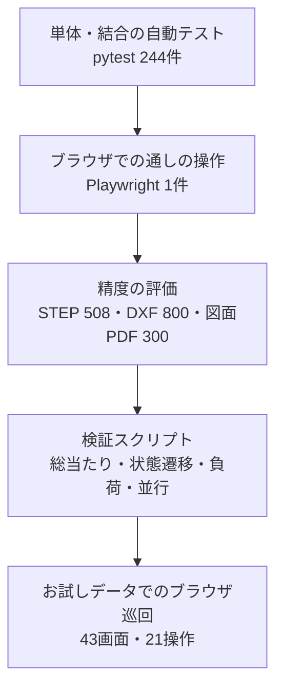

# テスト報告書
<!-- meta {"version": "1.0", "date": "2026-10-12", "audience": "経営者・顧客・開発者", "id": "DOC-09"} -->

## この資料について

このシステムを **どのように試験したか（テストの内容）** と、**その結果** をまとめる。対象は2026-10-12時点の `feature/ui-redesign` ブランチ（画面の改修と不具合修正を含む）である。

- 自動テスト（`python -m pytest -q`）の中身と結果
- 解析・図面読み取りの精度の評価の結果（詳しくは「評価報告書」）
- 2026-10-07〜10-12 に行った検証の記録：画面の改修の受入確認、ステータスの遷移と納品書の発行、システム全体の総当たり確認、ブラウザでの巡回、断続的なエラーの調査と負荷試験
- 見つけた不具合と直した内容
- まだ確かめていないこと

検証に使ったスクリプトは `scripts/verify/` にあり、同じ確認をやり直せる（9章「検証のやり直し方」）。どの試験も **Claude API（LLM）は呼んでいない**。図面PDFの読み取りは、記録済みの読み取り結果（`docs/scripts/recorded_reading.json`）か、読み取れない場合で確かめた。

## 結果のまとめ

| 試験 | 内容 | 結果 |
|---|---|---|
| 自動テスト | 22ファイル・245件（ブラウザでの通しの操作1件を含む） | **245件すべて合格**（約1分30秒） |
| STEPの解析の評価 | 開発用508件（`--verify-frozen --gate`） | **合格**。解析成功100%、危険誤答0% |
| 展開図DXFの解析の評価 | 開発用800ファイル（`--gate`） | **合格**。解析成功100%、危険誤答0% |
| 図面PDFの読み取りの評価 | 開発用300枚（2026-09-28 の結果。今回は実行していない） | 価格項目がすべて正しい 99.3%、危険誤答を含む図面 0% |
| ステータスの遷移と納品書 | 1つの案件を16の場面に動かし、画面の表示と実際の発行を比べる | **16/16 期待どおり**（修正前は発行の可否で1場面、次のアクションで3場面が食い違い） |
| API の総当たり確認 | 正しい操作と誤った入力を166とおり | **不具合0件**（修正前は9件） |
| ブラウザでの巡回 | 43画面を開き、主な操作21とおり | **画面のエラー0件・サーバーエラー0件** |
| 見積の作成の負荷試験 | 80件を6件ずつ同時に | **80件すべて成功**（修正前のコードは40件中3件がサーバーエラー） |
| 帳票の同時発行の負荷試験 | 見積書16・納品書8・請求書8を同時に | **全件成功・番号の重複なし**（修正前のコードは納品書7件・請求書7件がサーバーエラー） |
| CADデータの解析の並行試験 | 6スレッドで解析と3D表示の変換を同時に72回 | **72回すべて1回ずつの解析と同じ結果** |

「危険誤答」は、値が誤っているのに確定として表示されるもの（誤った金額がそのまま出る）を指す。

## 試験の全体像



| 層 | 何を確かめるか | いつ回すか |
|---|---|---|
| 自動テスト（pytest） | 解析・読み取り・見積の計算・帳票・API・画面用の判断（発行の可否、フェーズ、次のアクション）、データの保存、同時保存 | コードを変えるたびに必ず。全件合格が前提 |
| ブラウザでの通しの操作 | ホームから新規見積・解析・見積結果・帳票発行・受注・納品書と請求書・実績分析までが画面でつながる | 自動テストに含まれる（`web/dist` が必要） |
| 精度の評価 | 解析と読み取りが正しいか、誤った値を確定で出さないか | 解析・読み取りのコードを変えたとき（`--gate` で合否） |
| 検証スクリプト | 誤った入力でサーバーが落ちないか、同時に使って壊れないか、状態の組み合わせで食い違わないか | 画面用の API を大きく変えたとき |
| ブラウザ巡回 | 全画面が開けるか、主な操作で画面のエラーやサーバーエラーが出ないか | 画面を大きく変えたとき |

## 自動テスト（pytest）

`python -m pytest -q`（Windows では `.venv\Scripts\python.exe -m pytest -q`）。データベースは SQLite、LLM は記録済みの応答か偽のクライアントを使い、API を呼ばない。2026-10-12 の結果は **245件すべて合格**。

| ファイル | 件数 | 主な内容 |
|---|---:|---|
| `test_sheetmetal_analyzer.py` | 16 | STEPの解析：板厚・平板・複数穴・L/U/Z相当の曲げ・45/60/120度・異なるR・Kファクター・対象外の形・課金単位 |
| `test_sheetmetal_recognition.py`・`test_sheetmetal_geometry.py` | 5 | 板厚と表裏の認識、公差・面の隣接・2Dの包含 |
| `test_graph_unfold.py` | 9 | 展開（生成した部品が正しく展開される、ヘム、K≠0.5、自己検算が誤った展開を見つける） |
| `test_dxf_analyzer.py` | 19 | 展開図DXFの解析：注記・枠・寸法線を切断線にしない、すき間・重複線・インチ、開いた外形と2部品は確定にしない、曲げ線のない図面は平板と言われたときだけ確定 |
| `test_pdf_reader.py` | 62 | 図面PDFの読み取り：材質・表面処理・追加加工・数量・特急の規則、最新の改訂、手書きの特急、部品表、2回読みでの確認、壊れた出力の再試行、未登録・要確認は確定にしない |
| `test_estimate_conditions.py` | 6 | 図面の値と手入力の関係（手入力が優先、同じ加工を二重に数えない、表面処理「なし」は入力済み） |
| `test_quote_engine.py` | 6 | 見積の計算（材質の変更、追加加工、必要な値がないときは計算しない） |
| `test_quote_document.py` | 19 | 見積書：端数処理、確定の見積書は「御見積書」、社外用に原価・粗利を出さない、日本語フォント、長い文字が枠からはみ出さない、番号が重ならない、LLM とネットワークを使わない |
| `test_master_loader.py` | 5 | マスター：表記ゆれの結び付け、知らない語を似たコードに寄せない、課金の範囲の検査 |
| `test_similar_quotes.py` | 12 | 類似見積の規則（材料が同じ・曲げ数±1・穴数±2、差の小さい順）と過去見積の説明 |
| `test_chat_service.py` | 12 | チャットでの条件変更（数量・材質・皿もみ、曖昧な語は確認、知らない工程は足さない、APIの失敗で条件を壊さない、画面の入力例が反映される） |
| `test_claude_api.py` | 8 | Claude API のクライアント（キーの名前、記録と再利用、再生モードで API を呼ばない、LLM単独の解析器は常に概算） |
| `test_api.py` | 14 | 今までの API：受付がすぐ返る、ジョブが再起動後も残る、合言葉、アップロードの制限、エラーに内部のパスを出さない、3D表示 |
| `test_platform.py` | 12 | 画面用の API（下の表） |
| `test_golden_generator.py`・`test_dxf_golden.py`・`test_pdf_golden.py`・`test_stress_generator.py` | 34 | 正解データの生成器が凍結した正解と同じものを作る、評価の採点が正しい |
| `test_visualization.py`・`test_wording.py` | 5 | 展開図の描画、解析器のメッセージを使う人の言葉に言い換える |
| `test_e2e_flow.py` | 1 | ブラウザでの通しの操作（下の表） |

**画面用の API のテスト（`test_platform.py`）**：

| テスト | 確かめること |
|---|---|
| 金額が今の計算と同じで、画面・API・帳票PDFで一致 | 同じ入力なら改修前と同じ金額。画面・API・発行したPDFの金額が1円も違わない |
| 金額に必要な項目がすべて入ったときだけ発行できる | 材質未選択・マスタにない材料／加工／表面処理の単価なし・解析不可で寸法なし・数量なしでは発行できず、入れると発行できる。要確認・概算・表面処理「なし」では発行できる |
| 類似の規則が図面と見積で同じ | 図面の類似形状検索と見積の類似実績が同じ結果。材料・曲げ・穴の条件と並び順 |
| 再起動してもデータが残り、CSV が初期データ | API を起動し直しても図面・見積・マスターの変更が残る。評価用の CSV は変わらない |
| 古い版での保存は拒否する | 2人が同時に保存しても、後の保存は上書きせず409で知らせる |
| フェーズ・To Doリスト・次のアクションは API が決める | 初期ステータスのフェーズ、未入力でTo Doに載り入力すると外れる、発行で回答待ち、受注で納品書・請求書、ステータスの名前変更・追加でフェーズを保つ |
| 条件入力の下書きの印 | 読み取り結果に読取・要確認・マスタ未登録・記載なしの印、読み取りのない図面は推測で埋めない |
| フェーズのマイグレーション | 改修前のデータベース（表示グループ）からフェーズへ意味を保って移る |
| 納品書の発行がステータスに従う | 見積書の発行前の受注・見積提出済・失注では発行できず、受注以降（追加した完了分のステータスを含む）では発行できる |
| 設定の不正な値を、エラーでなく理由つきで断る | 検索条件・空のステータス名・担当者の名前の入れ替え・マスタの計算のしかた／単位・100%を超える率 |
| DXFの板厚の案内と、発行後の変更の注意 | 板厚のない展開図は「板厚」を求め、入れると解析される。見積書の発行後に条件を変えると納品書・請求書に注意が出る |
| 同時に保存しても番号が重ならない | 見積を8件同時に作っても、納品書を8件同時に発行しても、エラーにならず番号が重ならない |

**ブラウザでの通しの操作（`test_e2e_flow.py`）**：ホーム（To Doリストと進捗）→「＋ 新規見積」→ 図面PDF＋STEP を置く → 条件入力（読み取り結果が図番・数量・材質に入り、要確認と未登録の加工が示される）→ 解析・計算 → 見積結果（未登録の加工の単価が次のアクション。3Dと展開図が出る）→ 単価を入れる → 見積書の発行（画面の金額＝APIの金額）→ カンバンで受注へ → 納品書・請求書（3枚とも同じ金額）→ 実績分析の受注件数が1増える。

## 検証の記録（2026-10-07〜10-12）

### 画面の改修の受入確認（2026-10-07）

依頼「UI改修の依頼（板金見積）」の完了の条件に沿って確かめた。

| 条件 | 確かめ方 | 結果 |
|---|---|---|
| 画面案の9画面に対応する画面が動く | お試しデータでホーム・新規見積（2ステップ）・見積結果・見積・案件・図面・帳票発行・実績分析・設定を開き、写真を撮った（`docs/images/screens/`） | 動いた |
| `pytest` が全件通る、通しの操作を新しい流れに直す | 上の4章 | 合格 |
| お試しデータでブラウザから一連の操作 | 新しい図面（読み取れない図面PDF＋STEP）で 新規見積 → 条件入力 → 解析 → 材質の入力 → 見積書 → 受注 → 納品書・請求書。画面の総額 ¥62,910（税抜）、帳票3枚とも税込 ¥69,201 で API と一致。操作者は修正履歴・発行記録に残った | 通った |
| 古い URL が新しい画面に移る | `/estimates` → 見積・案件、`/partners` → 設定の取引先管理 | 移った |
| STEP・DXF の評価が合格のまま | `--gate` | 合格（精度の数字は変わらず、処理時間だけが変わった） |

### ステータスの遷移と納品書の発行（2026-10-12）

1つの案件のステータスを順に変え、各場面で「画面に返す発行の可否」「プレビュー」「実際の発行」「次のアクション」が食い違わないかを確かめた（`scripts/verify/check_delivery_status.py`）。

| 場面 | 納品書 | 次のアクション |
|---|---|---|
| 見積作成中（見積書は未発行） | 発行できない | 見積を表示 |
| 見積書の発行前に受注にした | 発行できない（先に見積書） | 見積書の発行 |
| 見積書を発行 → 自動で見積提出済 | 発行できない（受注前） | 受注・失注の登録 |
| 見積確認中に戻した | 発行できない | 見積を表示 |
| 受注 | 発行できた（見積書と同じ税込 ¥25,817） | 納品書の発行 → 請求書の発行 |
| 製造準備・製造中・検査・出荷待ち・出荷済・完了 | 発行できる | 請求書の発行 |
| 失注・保留 | 発行できない | 再見積／見積を表示 |
| 受注に戻した | 発行できる | 請求書の発行 |
| 追加したステータス（製造・出荷） | 発行できる | 請求書の発行 |
| 追加したステータス（完了分、例「納品済」） | 発行できる | 請求書の発行 |

**結果**：16/16 期待どおり。修正前は、追加した完了分のステータスで納品書が発行できない（1場面）、見積書の発行前の受注と出荷済・完了で次のアクションが誤る（3場面）、という食い違いがあった（6章の No.2・3）。

### システム全体の確認（2026-10-12）

**API の総当たり確認**（`scripts/verify/probe_api.py`）：画面が使う API のほぼすべてに、正しい操作と誤った入力を送った。誤った入力の例は、空欄・負の数・文字の入った数値・存在しない番号・別の図面の版・壊れたファイル・種類の違うファイル・古い版での保存・存在しないステータス・重複した名前・不正な JSON・100%を超える率。対象は図面・条件入力の下書き・見積・チャット・帳票・案件とステータス・担当者・分類・属性・テンプレート・取引先・マスター・検索・書類・CSVの取り込み・今までの API。

- 修正前：サーバーエラー（500）や不正な値の受付が9件（原因ごとにまとめると6章の No.4〜7）。No.8〜13 は、この確認の応答の読み直し・ブラウザ巡回・コードの見直しで見つけた
- 修正後：**166とおりで不具合0件**

**ブラウザでの巡回**（`scripts/verify/browser_sweep.py`）：お試しデータで起動し、43画面（全メニュー、全見積、全図面、設定の各画面、古い URL、存在しない URL）を開いたうえで、次の21とおりの操作を行った。画面の JavaScript のエラーと、500 の通信を記録した。

見積結果のタブと顧客提示モード、チャットでの数量変更、同時保存の拒否、未入力の材質の入力、マスタにない材質と加工の単価、帳票発行での案件の切り替え、カンバンのドラッグ、一覧からの失注（理由つき）、案件ステータスの追加（空の名前は断る）、担当者の名前の入れ替えと追加、価格方針の率の変更と戻し、テンプレート・属性項目・取引先の追加、CSVの取り込み、図面詳細のタブ、書類登録、ホームの To Do の全リンク、展開図DXFの図面登録から見積まで。

- **結果**：全操作が通り、画面のエラー0件、サーバーエラー0件。記録に残った 409 と 422 は、同時保存の拒否と空のステータス名の拒否を確かめるために、わざと起こしたもの

### 「同じデータでも見積がエラーになったりならなかったりする」の調査（2026-10-12）

利用者から、見積のときにときどきエラーになり、同じデータでもなる時とならない時があるという報告を受けて調べた。

| 疑ったこと | 確かめ方 | 結果 |
|---|---|---|
| CADデータの解析が実行ごとに違う | 同じSTEPを、異なるプロセス（ハッシュの種を変える）で12回解析 | 12回とも同じ結果。原因ではない |
| 解析を同時に動かすと壊れる | 6スレッドで、解析と3D表示の変換を同時に72回（`scripts/verify/analysis_threads.py`） | 72回とも1回ずつの解析と同じ。原因ではない |
| 見積の作成が同時に重なると失敗する | 図面の登録 → すぐに見積の作成、を並行して流す（`scripts/verify/stress_estimates.py`） | **再現した**。修正前のコードで40件中3件がサーバーエラー |
| 帳票の発行が同時に重なると失敗する | 見積書・納品書・請求書を同時に発行（`scripts/verify/stress_documents.py`） | **再現した**。修正前のコードで納品書7件・請求書7件がサーバーエラー |

**原因**：案件番号・納品書・請求書の番号を「今の番号を読む → 1足す → 書き戻す」で数えていた。2つの保存がほぼ同時に起きると両方が同じ番号を読み、同じ番号を書くので、後の保存が「番号の重複」でサーバーエラーになった。データの中身ではなく、ほかの保存（ほかの担当者の操作や、裏で動く図面の登録処理）と重なったかどうかで決まっていたため、同じデータでも失敗したりしなかったりした。

**修正**：番号はデータベース自身が `value = value + 1` で数える。番号の数え始め（年が変わって最初の案件など）も衝突しないようにした。見積書の再発行の枝番（`-2` など）も同じ仕組みにした（`src/services/platform/core.py` の `bump`）。

| 負荷試験 | 修正前（`feature/ui-wording`） | 修正後 |
|---|---|---|
| 見積の作成 40件（4件ずつ同時） | 成功37件、**サーバーエラー3件** | — |
| 見積の作成 80件（6件ずつ同時） | — | **80件すべて成功**（うち20件は未登録の加工の単価待ちで、想定どおり） |
| 帳票の同時発行（見積書16・納品書8・請求書8） | 納品書 **500が7件**、請求書 **500が7件** | **32件すべて成功、番号の重複なし** |

追加した自動テスト（同時に保存しても番号が重ならない）は、修正前の番号の数え方では3回中3回失敗し、修正後は合格する。

同じく「タイミングで失敗する」不具合として、見積の受付が見積の保存より先に始まり「見積が見つかりません」で失敗することがあった（2026-10-07 に修正。6章の No.1）。

## 見つけて直した不具合

| No. | 見つけた日 | 不具合 | 直した内容 | コミット |
|---:|---|---|---|---|
| 1 | 10-07 | 見積の受付が保存より先に始まり、まれに「見積が見つかりません」で失敗 | 保存してから受付を始める | b628303 |
| 2 | 10-12 | 見積書の発行前に受注にすると、次のアクションが「納品書の発行」（押しても発行は断られる） | 見積書の発行を案内する | 2308f25 |
| 3 | 10-12 | 完了分に追加したステータス（「納品済」など）に移すと、受注が未回答に戻り、納品書・請求書が発行できず実績分析から受注が消える | それまでの結果を引き継ぐ。出荷済・完了で請求書が未発行なら案内する | 2308f25 |
| 4 | 10-12 | 担当者の名前の入れ替え、削除した人の名前の再利用でサーバーエラー | 名前を一度空けてから付け直す。削除した人の名前は再利用できる | c8aa334 |
| 5 | 10-12 | 案件ステータスの名前が空白だけでも保存できる | 名前が空なら断る | c8aa334 |
| 6 | 10-12 | マスタの計算のしかた・単位に任意の文字、価格方針の率に上限なし（消費税率 10 が 1000%） | 決まった値・0〜100% だけを受け付ける | c8aa334 |
| 7 | 10-12 | 図面の検索条件に数値でない値を渡すとサーバーエラー | 理由つきで断る（400） | c8aa334 |
| 8 | 10-12 | 取引先の平均納期・取引件数に負の値が入る | 0以上だけ | c8aa334 |
| 9 | 10-12 | チャットの入力例「数量を200に」「皿もみを4か所追加」が、OpenAI のキーがない環境で反映されない | 簡易の解釈で「か所」「数量を○に」を読む | c8aa334 |
| 10 | 10-12 | 入力の誤りが英語で表示される | 欄の名前と直し方を日本語で返す | c8aa334 |
| 11 | 10-12 | 板厚のない展開図（DXF）で寸法5つの手入力を求める | 「板厚」を求め、入れると解析する | c8aa334 |
| 12 | 10-12 | 見積書の発行後に条件を変えても、納品書・請求書が古い金額で作られることを知らせない | 帳票発行と見積結果に注意を出す（発行は止めない） | c8aa334 |
| 13 | 10-12 | 帳票発行で案件を切り替えても、テンプレートが最初の顧客のまま | 案件ごとに顧客のテンプレートを選び直す | c8aa334 |
| 14 | 10-12 | 同時に保存すると案件番号・帳票番号が重複し、見積の作成・帳票の発行がサーバーエラー（5.4） | 番号をデータベースが原子的に数える | 61594d9 |

## 精度の評価（解析・読み取り）

解析と金額の計算のコードは、今回の改修と修正で変えていない。STEP と DXF は2026-10-12にも評価を回し、合格のままだった。詳しい内容は「評価報告書」と `analysis/*_eval_*.md` にある。

| 対象 | データ | 解析成功・正解 | 危険誤答 | 判定 |
|---|---|---|---|---|
| STEP（開発用） | 508件（5レベル＋手作り） | 解析成功100%、確定で正解100% | 0% | 合格 |
| STEP（最終判定用 seed=3・4） | 各1,000件 | `analysis/golden_eval_seed3.md`・`seed4.md` | 0件 | 合格 |
| STEP（作り方を変えたストレステスト） | 480件・12区分 | 11区分で95〜100%。閉じた筒40件は全件「概算」 | 0件 | 閉じた筒は確定にしない（想定どおり） |
| 展開図DXF（最終判定用 seed=23） | 800ファイル | 解析成功100%、X は全件解析不可（`analysis/dxf_eval_seed23.md`） | 0% | 合格 |
| 展開図DXF（開発用） | 800ファイル | 解析成功100%（確定で正解 D0・D1 80%、D2 58%、残りは正解だが概算）。X（確定してはいけない）は全件解析不可 | 0% | 合格 |
| 図面PDF（開発用） | 300枚（2026-09-28） | 価格項目がすべて正しい99.3%、自動確定92.7% | 図面単位0% | 合格 |

図面PDFの評価は、1回で数百回の Claude API の呼び出しになるので、今回は実行していない。読み取り器のコード（`src/pdf_reader.py`・`src/pdf_terms.py`）は変えていない。

## 確かめていないこと

| 項目 | 状況 | 影響 |
|---|---|---|
| PostgreSQL での実行 | 試験はすべて SQLite。番号の修正は PostgreSQL でも同じ書き方（`INSERT … ON CONFLICT DO NOTHING` と `UPDATE … value + 1`）にしてあるが、動かしてはいない。フェーズのマイグレーション（`0002`）も SQLite でだけ確かめた | 本番で PostgreSQL を使う前に、負荷試験とマイグレーションを PostgreSQL で回す |
| Docker・Windows | 動かしていない（Linux で確認） | 導入時に `docker compose up` と Windows の手順を確かめる |
| 図面PDFの実際の読み取り | Claude API は呼んでいない。記録済みの1枚と、読み取れない場合だけ | 新しい図面の読み取りの精度は、9月の評価の結果による |
| ブラウザの種類・画面の幅 | Chromium（1440×950）だけ | Edge・小さい画面での見え方は未確認 |
| 実際の顧客の図面 | 評価は合成した図面とSTEPだけ | 実際のCADのデータの癖は未検証（評価報告書を参照） |
| 帳票発行のテンプレートの切り替え | お試しデータでは顧客ごとのテンプレートがなく、巡回では同じテンプレートのままだった | 直したコードは確認したが、別テンプレートでの動作は画面で見ていない |
| 大量のデータ | 案件・図面は数十件まで | 数千件での表示の速さは未確認 |

## 検証のやり直し方

```
python -m pytest -q                                     # 自動テスト（web/dist があればブラウザの通しの操作も）
python scripts/evaluate_golden.py --data golden_data --verify-frozen --tolerance 0.10 --gate --report analysis/golden_eval_latest.md
python scripts/evaluate_dxf.py --data dxf_data --analyzer src.dxf_analyzer:DxfAnalyzer --verify-frozen --gate --report analysis/dxf_eval_latest.md

python scripts/verify/check_delivery_status.py          # 5.2 ステータスの遷移と納品書（16場面）
python scripts/verify/probe_api.py                      # 5.3 API の総当たり（166とおり）
python scripts/verify/stress_estimates.py 80 6          # 5.4 見積の作成の負荷試験（80件・6件ずつ同時）
python scripts/verify/stress_documents.py               # 5.4 帳票の同時発行
python scripts/verify/analysis_threads.py               # 5.4 CADデータの解析の並行試験
python scripts/verify/browser_sweep.py                  # 5.3 ブラウザ巡回（お試しデータで API を起動してから）
```

- どのスクリプトも一時的な保存先を使い、コミットされた履歴とマスターの CSV は変えない。問題があれば終了コード1で終わる
- 修正前のコードと比べるときは、別の作業コピー（例：`git worktree add ../old origin/feature/ui-wording`）を `--root ../old` で指定する（`stress_estimates.py`・`stress_documents.py`）
- ブラウザ巡回は、`python scripts/seed_demo.py --storage output/demo --fresh` のあと、`ESTIMATE_STORAGE_DIR=output/demo`・`PAST_QUOTES_PATH=output/demo/history.csv`・`DRAWING_READER=recorded:output/demo/readings.json` を設定して `uvicorn api.main:app --port 8000` で起動しておく
